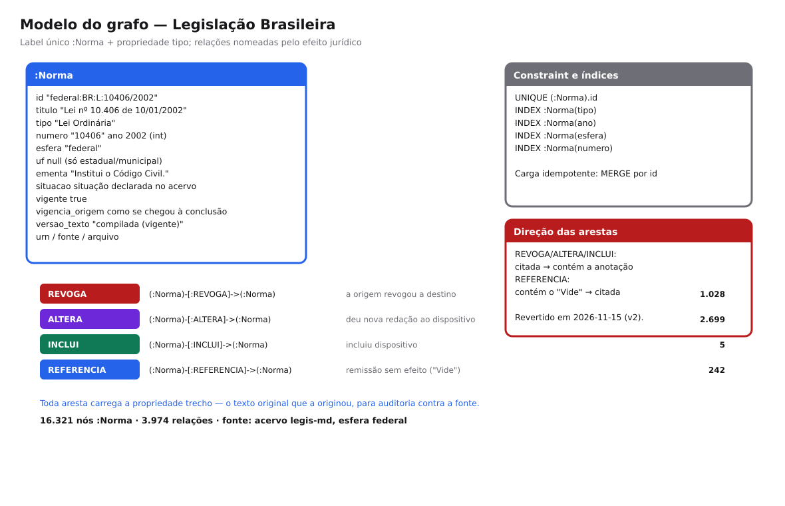
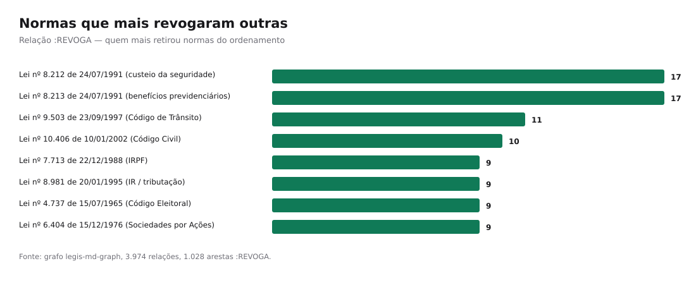
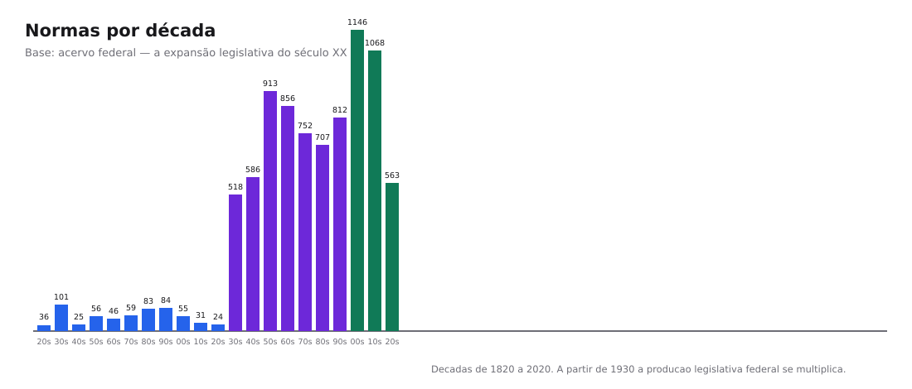

# Grafo da Legislação Brasileira — Neo4j

[](https://neo4j.com)
[](https://neo4j.com/docs/cypher-manual/)
[](LICENSE)

Modelagem do ordenamento jurídico brasileiro como grafo de propriedades, a partir do acervo
público [legis-md](https://github.com/jonydevrio/legis-md) — legislação em Markdown derivada
de fontes oficiais (Planalto, normas.leg.br, assembleias estaduais).

**16.321 normas** federais conectadas por **3.974 relações** de revogação, alteração,
inclusão e remissão, extraídas do próprio texto das leis.

O objetivo é responder perguntas que uma tabela responde mal: *quais normas alteraram o
Código Civil*, *que lei revogou qual*, *quais normas estão no centro do ordenamento* e
*quais cadeias de revogação existem*.



---

## Índice

- [1. O problema e por que grafo](#1-o-problema-e-por-que-grafo)
- [2. Modelo do grafo](#2-modelo-do-grafo)
- [3. Dataset e carga](#3-dataset-e-carga)
- [4. Perguntas de negócio e resultados](#4-perguntas-de-negócio-e-o-que-o-grafo-respondeu)
- [5. Dificuldades encontradas](#5-dificuldades-encontradas-e-como-resolvi)
- [6. Estrutura do repositório](#6-estrutura-do-repositório)
- [7. Próximos passos](#7-próximos-passos)
- [8. Fonte e limites](#8-fonte-e-limites)

---

## 1. O problema e por que grafo

Uma lei brasileira não existe isolada: ela revoga, altera, inclui dispositivos e remete a
outras normas. O próprio texto traz essas relações anotadas — `*(Revogado pela Lei nº
13.146, de 6/7/2015)*` é uma aresta esperando ser lida.

| Abordagem | O que ela responde bem | Onde ela quebra |
| --- | --- | --- |
| Planilha / SQL relacional | listar normas, filtrar por ano ou tipo | "quais normas, em qualquer profundidade, alteraram o Código Civil?" exige N *joins* com N desconhecido |
| Busca textual | encontrar onde a lei é citada | não distingue *citar* de *revogar*, nem dá a direção do efeito |
| **Grafo** | travessia de relações, centralidade, caminhos | agregações tabulares puras (mas Cypher faz isso também) |

A pergunta que melhor justifica o grafo é a **cadeia de revogação**: `Lei A revogou Lei B,
que já havia revogado Lei C`. Num modelo relacional isso exige uma CTE recursiva; no grafo
é uma linha:

```cypher
MATCH caminho = (a:Norma)-[:REVOGA*2..3]->(c:Norma)
RETURN a.titulo, c.titulo, length(caminho)
```

---

## 2. Modelo do grafo

### Label único, relações nomeadas pelo efeito

```cypher
(:Norma {
  id, titulo, tipo, numero, ano, data, esfera, uf,
  ementa, situacao, vigente, vigencia_origem,
  versao_texto, urn, fonte, arquivo
})
```

**Decisão de modelagem: um único label `:Norma` com a propriedade `tipo`**, em vez de um
label por tipo (`:Lei`, `:LeiComplementar`, `:Decreto`). O motivo é prático: quase toda
consulta de negócio atravessa tipos — "o que alterou o Código Civil?" cruza Lei, Lei
Complementar e Decreto. Com um label por tipo, seria preciso repetir a query uma vez por
label e unir os resultados.

O custo dessa escolha é que filtros por tipo usam `WHERE n.tipo = '...'` em vez de
`:Lei`. Como `tipo` tem índice, a diferença é irrelevante nesta escala.

### Relações

| Relação | Significado | Veio de |
| --- | --- | --- |
| `(:Norma)-[:REVOGA]->(:Norma)` | a origem revogou a destino | `*(Revogado pela Lei ...)*` |
| `(:Norma)-[:ALTERA]->(:Norma)` | deu nova redação a dispositivo | `*(Redação dada pela Lei ...)*` |
| `(:Norma)-[:INCLUI]->(:Norma)` | incluiu dispositivo | `*(Incluído pela Lei ...)*` |
| `(:Norma)-[:REFERENCIA]->(:Norma)` | remissão sem efeito modificativo | `*(Vide Lei ...)*` |

**Direção: sempre de quem produz o efeito para quem o recebe.** Assim o grau de entrada de
um nó mede quantas normas o afetaram — que é a métrica útil.

Toda aresta carrega a propriedade **`trecho`**: o texto original que a originou. Isso
permite auditar qualquer relação contra a fonte e é o que separa um grafo confiável de uma
caixa-preta.

Distribuição real das arestas no grafo carregado:

| Relação | Arestas |
| --- | ---: |
| `ALTERA` | 2.699 |
| `REVOGA` | 1.028 |
| `REFERENCIA` | 242 |
| `INCLUI` | 5 |
| **Total** | **3.974** |

### Constraints

```cypher
CREATE CONSTRAINT norma_id IF NOT EXISTS
FOR (n:Norma) REQUIRE n.id IS UNIQUE;

CREATE INDEX norma_tipo   IF NOT EXISTS FOR (n:Norma) ON (n.tipo);
CREATE INDEX norma_ano    IF NOT EXISTS FOR (n:Norma) ON (n.ano);
CREATE INDEX norma_esfera IF NOT EXISTS FOR (n:Norma) ON (n.esfera);
CREATE INDEX norma_numero IF NOT EXISTS FOR (n:Norma) ON (n.numero);
```

O `UNIQUE` em `id` torna a carga **idempotente**: rodar `LOAD CSV` duas vezes não duplica
nós, porque o `MERGE` casa pela chave.

---

## 3. Dataset e carga

### De onde vêm os dados

O acervo tem **1,1 milhão de arquivos** (4,2 GB) — federal, estadual, municipal,
reguladores, jurisprudência e tratados. Cada arquivo é um `.md` com frontmatter YAML:

```yaml
---
titulo: "Lei nº 10.406 de 10/01/2002"
tipo: "Lei Ordinária"
numero: "10406"
data: 2002-01-10
ementa: "Institui o Código Civil."
revogada: false
versao_texto: "compilada (texto vigente)"
urn: "urn:lex:br:federal:lei:2002-01-10;10406"
---
```

**Este projeto carrega a esfera federal:** 16.446 normas lidas, 5.349 correlações extraídas
do texto, resultando em **16.321 nós** com chave única e **3.974 relações** depois de
descartar as que apontam para normas fora do escopo.

### Como rodar

```bash
pip install -r requirements.txt

# 1. Extrair os CSVs do acervo (precisa do repositório legis-md clonado)
python3 scripts/extract.py /caminho/legis-md data

# 2. Carregar no Neo4j (precisa de APOC)
python3 scripts/load.py --uri bolt://localhost:7687 --user neo4j --pass SUA_SENHA

# 3. Rodar as 10 queries de negócio
python3 scripts/run_query.py

# 4. Gerar as evidências visuais
python3 scripts/gerar_imagens.py
```

Ou, pelo Neo4j Browser, com os CSVs em `<NEO4J_HOME>/import/`, seguindo
[`cypher/load_csv.cypher`](cypher/load_csv.cypher) na ordem: constraints → nós → relações.

### Abrir o grafo no seu Neo4j

O guia completo está em **[docs/IMPORTAR.md](docs/IMPORTAR.md)**, com quatro caminhos:

| Você tem | Caminho |
| --- | --- |
| Neo4j de qualquer versão | A — arquivo `.cypher` |
| Neo4j 5.x | B — dump binário |
| Nada instalado | C — Neo4j Aura Free |
| O acervo e quer gerar do zero | D — `LOAD CSV` |

O grafo já carregado está pronto para uso, sem precisar rodar nada:

| Arquivo | Tamanho | Como usar |
| --- | ---: | --- |
| [`export/legis-graph.cypher`](export/legis-graph.cypher) | 11 MB | funciona em **qualquer** versão do Neo4j |
| [`export/legis-graph-neo4j5.dump`](export/legis-graph-neo4j5.dump) | 13 MB | restauração nativa, exige Neo4j 5.x |

Para importar, siga o caminho A ou B de [`docs/IMPORTAR.md`](docs/IMPORTAR.md). O mais
rápido, com o Neo4j já rodando:

```bash
cypher-shell -a bolt://localhost:7687 -u neo4j -p SUA_SENHA -f export/legis-graph.cypher
```

Conferência esperada: `16.321` nós e `3.974` relações.

Se quiser **regenerar** os arquivos a partir do seu próprio banco, use
`python3 scripts/exportar.py --pass SUA_SENHA`. O dump binário exige o Neo4j parado; o
script imprime os comandos exatos e o guia explica o detalhe do nome do arquivo, que é a
causa mais comum de falha na restauração.

---

## 4. Perguntas de negócio e o que o grafo respondeu

Todas as queries estão comentadas em [`cypher/queries_negocio.cypher`](cypher/queries_negocio.cypher).
Os números abaixo são a execução real sobre as 16.446 normas federais.

### Q1. Como se compõe o acervo federal?

| Tipo | Normas |
| --- | ---: |
| Lei Ordinária | 15.928 |
| Lei Complementar | 221 |
| Emenda Constitucional | 166 |
| Emenda Constitucional de Revisão | 6 |

### Q2. Quais normas mais revogaram outras?



| Norma | Revogações |
| --- | ---: |
| Lei nº 8.212/1991 (custeio da seguridade social) | 17 |
| Lei nº 8.213/1991 (benefícios da Previdência) | 17 |
| Lei nº 9.503/1997 (Código de Trânsito) | 11 |
| Lei nº 10.406/2002 (Código Civil) | 10 |
| Lei nº 7.713/1988 (IRPF) | 9 |

O resultado tem coerência jurídica: os dois diplomas que reescreveram a Previdência em 1991
lideram, como se espera de normas que substituíram legislação esparsa anterior.

### Q3. Quais normas estão no centro do ordenamento (mais citadas)?

| Norma | Citações |
| --- | ---: |
| Emenda Constitucional nº 32/2001 | 53 |
| Lei nº 13.328/2016 | 44 |
| Lei Complementar nº 214/2025 (reforma tributária) | 39 |

A EC 32/2001 no topo é um achado interessante: ela trata de medidas provisórias e é citada
por dezenas de normas posteriores que precisam ressalvar seu regime.

### Q4. Existem cadeias de revogação?

Sim — a consulta `(a)-[:REVOGA*2..3]->(c)` retorna caminhos reais, por exemplo a Lei nº
3.826/1960 chegando à Lei nº 13.328/2016 em 3 saltos. É a pergunta que o modelo relacional
responderia com CTE recursiva e que no grafo cabe uma linha.

### Q5. Quais normas são simultaneamente fonte e alvo de mudanças?

| Norma | Altera | É alterada por | Centralidade |
| --- | ---: | ---: | ---: |
| Lei nº 8.212/1991 | 37 | 11 | 48 |
| Lei nº 10.406/2002 (Código Civil) | 30 | 13 | 43 |
| Lei nº 11.907/2009 | 22 | 21 | 43 |

### Q6. Em que período o Brasil mais legislou?



### Q7. Quais normas alteraram o Código Civil?

```cypher
MATCH (cc:Norma {numero: '10406', ano: 2002})
MATCH (alteradora:Norma)-[r:ALTERA|REVOGA]->(cc)
RETURN type(r) AS relacao, alteradora.titulo, r.trecho
```

Retorna, entre outras: Lei 13.874/2019 (liberdade econômica), Lei 11.977/2009 (Minha Casa
Minha Vida), LC 123/2006 (MEI), Lei 10.820/2003 (consignado). Cada linha vem com o `trecho`
que comprova a aresta.

### Q8. Quanto do acervo está isolado?

**13.582 normas não têm nenhuma aresta.** Isso não é falha do modelo: é a realidade do
acervo. Leis orçamentárias, atos de pessoal e normas de efeito único raramente citam ou são
citadas. Documentar esse número é mais honesto do que escondê-lo.

---

## 5. Dificuldades encontradas (e como resolvi)

Esta seção existe porque os obstáculos foram reais e o aprendizado vale mais que o resultado.

### 5.1 O repositório de origem tem 4,2 GB

`git clone` falhou com `fatal: write error: Bad file descriptor` ao tentar baixar tudo.

**Solução:** clone sem blobs para mapear a estrutura, depois *sparse checkout* só das pastas
necessárias:

```bash
git clone --filter=blob:none --no-checkout --depth 1 https://github.com/jonydevrio/legis-md.git
cd legis-md
git sparse-checkout init --cone
git sparse-checkout set federal/leis-ordinarias federal/leis-complementares federal/emendas-constitucionais
git checkout main
```

Resultado: 957 MB em vez de 4,2 GB, com as 17.200 normas federais necessárias.

### 5.2 O ambiente é Alpine (musl), e o JDK padrão não roda

Baixei o Temurin 17 e recebi `Unable to load jimage library: libjimage.so`. O `ldd` mostrou
a causa: o binário é glibc, e o sistema usa `/lib/ld-musl-aarch64.so.1`.

**Solução:** usar uma build musl do Liberica JDK 21 (BellSoft), que é a versão que o Neo4j
5.x exige:

```bash
curl -L -o jdk21.tar.gz "https://github.com/bell-sw/Liberica/releases/download/21.0.13.0.3%2B6/bellsoft-jdk21.0.13.0.3+6-linux-aarch64-musl-crac.tar.gz"
```

### 5.3 APOC não vem ativado, mas vem incluído

`apoc.merge.relationship` não existia. O JAR está em `labs/`, não em `plugins/`.

**Solução:**

```bash
cp labs/apoc-5.26.0-core.jar plugins/apoc.jar
```

E no `conf/neo4j.conf`:

```properties
dbms.security.procedures.unrestricted=apoc.*
dbms.security.procedures.allowlist=apoc.*
```

O `allowlist` sozinho não basta: sem `unrestricted`, o APOC recusa procedimentos de escrita.

### 5.4 `CredentialsExpired` no primeiro acesso

O driver devolvia `ACCESS on database 'neo4j' is not allowed`, mesmo com a senha correta.

**Solução:** a troca de senha tem de ser no banco `system`, não no `neo4j`:

```python
with driver.session(database="system") as s:
    s.run("ALTER CURRENT USER SET PASSWORD FROM 'neo4j' TO 'nova-senha'").consume()
```

### 5.5 O campo `revogada` é `null` em 60% dos arquivos — e isso quase estragou o dataset

A primeira versão do extrator tratou `revogada: null` como "não vigente". Resultado: o
acervo inteiro seria descartado.

Medindo 60 arquivos aleatórios: `revogada` existe em 100% deles, mas os valores são
`null` (36), `false` (22) e `true` (2). O campo `situacao` aparece em apenas 12.

**Solução:** inverter a lógica e tornar a decisão auditável. Uma norma é excluída apenas
quando há afirmação positiva de revogação (`revogada: true` ou `situacao` contendo
"revogad"), e cada linha grava em `vigencia_origem` como se chegou à conclusão. Os 16.446
nós carregados têm essa trilha.

**Limitação que assumo explicitamente:** o acervo não informa a vigência de forma
confiável para a maioria das normas. Este grafo representa **normas com texto disponível e
sem revogação declarada**, o que é diferente de "normas em vigor". A distinção está
documentada no modelo, na propriedade `vigencia_origem`.

### 5.6 O extrator marcava *citação* como *alteração*

A primeira versão lia a linha inteira e aceitava qualquer norma mencionada. Isso gerou um
falso positivo claro: um trecho dizendo "associação constituída nos termos dos arts. 53 a
61 da Lei nº 10.406" foi registrado como se aquela lei **alterasse** o Código Civil. Ela
apenas o invoca.

**Solução:** amarrar o marcador à citação numa única expressão regular, exigindo que o
número venha imediatamente depois de `Revogado pela`, `Redação dada pela`, etc. Efeito:
as correlações caíram de 10.232 para 5.349 — quase metade era ruído — e o teste de
regressão com o caso acima passou a retornar vazio.

```python
PADROES_PROXIMOS = [
    (nome, re.compile(padrao + r'\s*' + TIPO_NO_TEXTO + CITACAO, re.I))
    for nome, padrao in MARCADORES.items()
]
```

### 5.7 Relações órfãs

1.373 das 5.349 correlações não encontraram destino no grafo, porque a norma citada é
anterior ao escopo coletado ou pertence a outra esfera. Elas são **descartadas com
contagem explícita** no log, não silenciosamente — e a query de carga usa `MATCH`, nunca
`MERGE` cego, para não criar nós fantasmas com apenas um número.

### 5.8 APOC grava no `import/`, não no caminho pedido

`apoc.export.cypher.all('/caminho/absoluto/arquivo.cypher')` falhou com
`FileNotFoundException` apontando para `.../import/home/...`.

**Solução:** o caminho é sempre relativo a `<NEO4J_HOME>/import/`. O `scripts/exportar.py`
já exporta com caminho relativo e move o resultado para `export/`.

---

## 6. Estrutura do repositório

```
README.md                  este documento
cypher/
  modelo_grafo.cypher      schema comentado + exemplo mínimo (abre no Arrows.app)
  load_csv.cypher          carga via LOAD CSV, em ordem, com alternativa sem APOC
  queries_negocio.cypher   10 queries comentadas, uma por pergunta de negócio
docs/
  modelo_grafo.svg         diagrama do schema (labels, propriedades, relações)
  normas_por_decada.svg    volume legislativo por década
  top_revogadoras.svg      normas que mais revogaram
  IMPORTAR.md              como abrir o grafo no seu Neo4j (4 caminhos)
import/
  amostra_normas.csv       amostra versionada de 10 normas
  amostra_correlacoes.csv  amostra versionada de correlações com trecho
data/                      CSVs gerados por extract.py (não versionados)
export/
  legis-graph.cypher       grafo completo — importa em qualquer versão do Neo4j
  legis-graph-neo4j5.dump  dump binário nativo (Neo4j 5.x)
scripts/
  extract.py               extrai nós e arestas do acervo Markdown
  load.py                  carrega no Neo4j via driver Python
  run_query.py             roda as 10 queries e imprime as tabelas
  gerar_imagens.py         gera as evidências visuais (Pillow)
  exportar.py              gera o .cypher e as instruções do dump
```

---

## 7. Próximos passos

- **Esferas estaduais e municipais.** O extrator já reconhece `esfera` e `uf` pelo caminho;
  falta volume de dados (749 mil arquivos estaduais).
- **Jurisprudência e tratados** como nós de outra categoria, ligados às normas que
  interpretam.
- **Busca semântica** sobre o texto das ementas, para além da travessia de relações.
- **GDS**: `gds.wcc` para componentes conexos e `gds.betweenness` para centralidade real,
  hoje aproximada por grau.
- **Vigência pela via oficial.** Consultar o `urn:lex` de cada norma para obter a situação
  atual, em vez de depender do frontmatter.

---

## 8. Fonte e limites

Dados de [jonydevrio/legis-md](https://github.com/jonydevrio/legis-md), fork do repositório
original, criado por C3B, localizado em [ctresb/leis](https://github.com/ctresb/leis), 
conversões automáticas de fontes oficiais (Planalto, normas.leg.br, assembleias estaduais).
O próprio acervo adverte: *"os textos têm caráter informativo e não substituem a publicação
no Diário Oficial"*.

Este grafo herda essa limitação e acrescenta as suas: a extração de correlações é
heurística, baseada nos marcadores que o Planalto insere no texto, e não substitui a análise
da norma. A propriedade `trecho` existe exatamente para que cada aresta possa ser conferida
na fonte.

Projeto desenvolvido como desafio prático da [DIO](https://www.dio.me) sobre bancos de
dados em grafos com Neo4j.

## Licença

Código sob MIT. O conteúdo normativo é de domínio público (Lei 9.610/98, art. 8º, IV).
